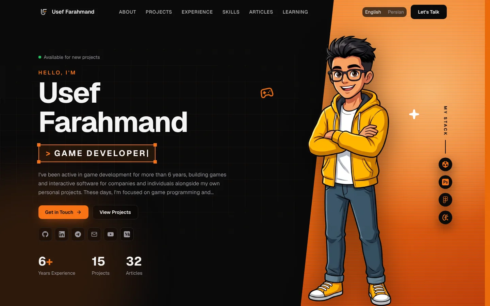
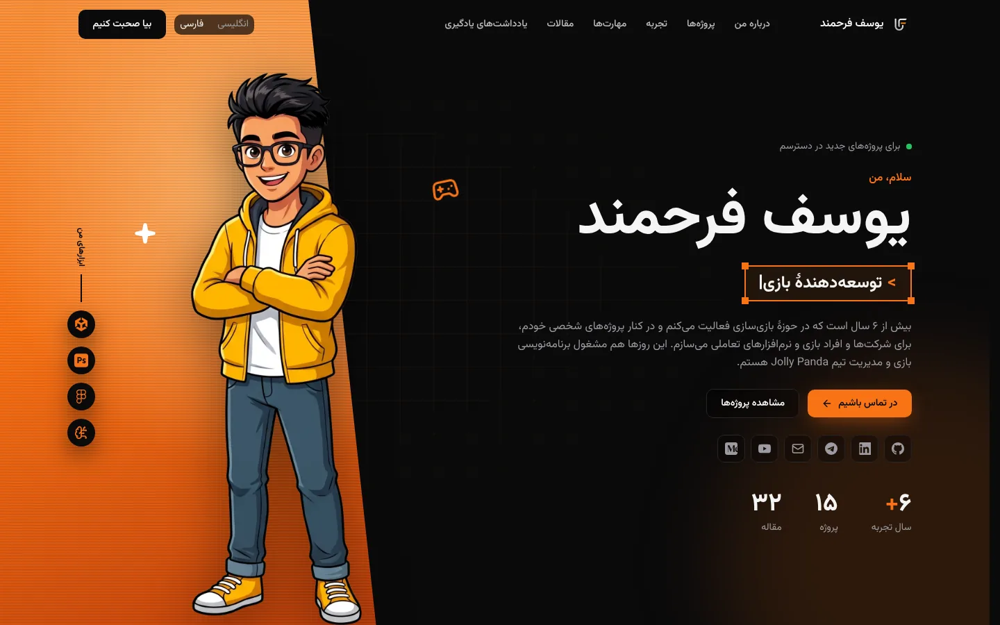

<!-- ========================= HEADER ========================= -->

<p align="center">
  
</p>

<p align="center">
  <a href="https://www.useffarahmand.com"></a>
  <a href="https://www.useffarahmand.com/fa"></a>
  <a href="./LICENSE"></a>
</p>

---

<table>
<tr>

<td width="70%" valign="middle">

# 🌐 My Corner of the Internet

### 🎮 The personal website of Usef Farahmand: game developer, technical artist, and founder of Jolly Panda

This repository holds the source of **[useffarahmand.com](https://www.useffarahmand.com)**, my bilingual portfolio, in **English and Persian (RTL)**. It covers my projects, work experience, skills, articles, learning notes, and recommendations.

The site is meant to be explored, not just read like a resume.

</td>

<td width="30%" align="center" valign="middle">


</td>

</tr>
</table>

---

## 🖼️ Preview

<p align="center">
  
  
</p>

---

## ✨ What's Inside

- 🌍 **Two languages, one site.** English and Persian, with full right-to-left layout and Persian digits.
- 🧭 **Location-aware.** Visitors from Iran land on the Persian version, and a manual language choice is remembered.
- 🎮 **Projects and games.** Shipped titles, prototypes, and playable work, with galleries and videos.
- ✍️ **Articles and learning notes.** Writing about game development, design, and the industry.
- 📬 **A real contact form.** Messages are sent server-side. Each sender gets a confirmation email in the language they wrote in.
- 🎞️ **Purposeful motion.** Animations that respect `prefers-reduced-motion`.
- ♿ **Accessible and responsive.** Built mobile-first, with keyboard and screen-reader support.

---

## 🛠️ Built With

<p align="center">
  <a href="https://nextjs.org/"></a>
  &nbsp;&nbsp;
  <a href="https://react.dev/"></a>
  &nbsp;&nbsp;
  <a href="https://www.typescriptlang.org/"></a>
  &nbsp;&nbsp;
  <a href="https://tailwindcss.com/"></a>
  &nbsp;&nbsp;
  <a href="https://vercel.com/"></a>
  &nbsp;&nbsp;
  <a href="https://git-scm.com/"></a>
</p>

```yaml
framework: Next.js 16 (App Router) · React 19 · TypeScript
styling: Tailwind CSS 4 · design tokens
i18n: next-intl (en / fa, RTL)
motion: anime.js
ui: Radix UI · lucide-react
fonts: Geist · Geist Mono · Vazirmatn (self-hosted)
email: EmailJS REST API (server-side)
hosting: Vercel
```

---

## 🗂️ Project Structure

```text
src/
├── app/              # App Router: localized pages under [locale]/, plus api/contact
├── components/       # UI components, grouped by feature and layout
├── config/           # Deployment facts (domains, brand assets)
├── content/          # All site content: one folder per content type, en + fa
├── i18n/             # next-intl routing and request config
├── messages/         # Static UI strings (en.json / fa.json)
├── services/         # Content access and the contact form's send path
├── lib/ · hooks/     # Utilities and React hooks
├── styles/           # Global styles and design tokens
└── types/            # Shared TypeScript types
doc/                  # Planning, architecture, design and content guides
public/               # Images, documents and other static files
```

Every piece of content keeps its **shared fields** (dates, links, media) apart from a **`translations`** map with one entry per language. A missing Persian entry falls back to English.

---

## 🚀 Running It Locally

```bash
git clone https://github.com/Usef-Farahmand/Personal-Website-Source.git
cd Personal-Website-Source
npm install
npm run dev
```

Then open [localhost:3000](http://localhost:3000). Both languages live at `/en` and `/fa`.

```bash
npm run build          # production build
npm run start          # serve the production build
npm run lint           # ESLint
npm run format:check   # Prettier check
```

The contact form needs EmailJS credentials. Copy [`.env.example`](./.env.example) to `.env.local` and fill it in. Without them, the form shows a friendly "not available" message, and everything else works. Setup details are in [`doc/EMAILJS_SETUP.md`](./doc/EMAILJS_SETUP.md).

---

## 📚 Documentation

| Document                                                               | What it covers                                            |
| ---------------------------------------------------------------------- | --------------------------------------------------------- |
| [`doc/CONTENT_GUIDE_fa.md`](./doc/CONTENT_GUIDE_fa.md)                 | Which file to edit for each part of the site (in Persian) |
| [`doc/EMAILJS_SETUP.md`](./doc/EMAILJS_SETUP.md)                       | Contact form and email setup (in Persian)                 |
| [`doc/DESIGN_SYSTEM.md`](./doc/DESIGN_SYSTEM.md)                       | Colors, typography, spacing and components                |
| [`doc/INFORMATION_ARCHITECTURE.md`](./doc/INFORMATION_ARCHITECTURE.md) | Pages, navigation and content structure                   |
| [`doc/CONTRIBUTING.md`](./doc/CONTRIBUTING.md)                         | Engineering standards used in this codebase               |

---

## 📄 License & Reuse

This is a **personal website, not a software project**, so it isn't open source. Everything here is © Usef Farahmand, all rights reserved. The text, artwork, photos, résumé, logos, and the Jolly Panda brand are mine, and so is the site's design.

You're welcome to **read the code and learn from it**, and to reuse small, generic snippets or techniques in your own work. Please don't republish this site, its design, or its content, or present them as your own. The full terms are in [`LICENSE`](./LICENSE). Third-party packages and fonts keep their own licenses.

Spotted a bug, typo, or broken link? [Open an issue](https://github.com/Usef-Farahmand/Personal-Website-Source/issues). For security problems, see [`SECURITY.md`](./SECURITY.md).

---

## 🌐 Find Me

<p align="center">
  <a href="https://useffarahmand.com"></a>
  <a href="https://github.com/Usef-Farahmand"></a>
  <a href="https://www.linkedin.com/in/useffarahmand/"></a>
  <a href="https://t.me/UsefGameLab"></a>
  <a href="https://medium.com/@UsefFarahmand"></a>
  <a href="https://www.youtube.com/@UsefFarahmand"></a>
</p>

&nbsp;&nbsp;

<!-- ========================= FOOTER ========================= -->

<p align="center">
  <b>Build. Experiment. Play. Repeat.</b>
  &nbsp;&nbsp;
  
</p>

<p align="center">
  
</p>
